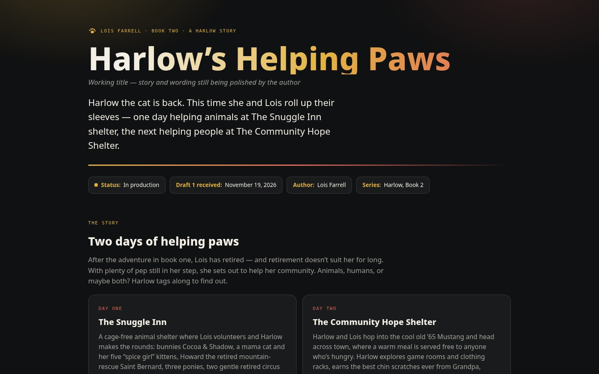

# Harlow's Helping Paws

> Harlow the cat is back. This time she and Lois roll up their sleeves — one day helping animals at The Snuggle Inn shelter, the next helping people at The Community Hope Shelter.

**Branch policy:** work happens on the latest *-vN / project branch. List branches before editing. Never assume the GitHub default is the working line. Working line: `harlows-helping-paws-v1` (GitHub default is `main`).

[](https://mydigitalstudioz.github.io/Harlows-Helping-Paws/)
[](https://github.com/MyDigitalStudioz/Harlows-Helping-Paws/actions/workflows/pages/pages-build-deployment)
[](https://github.com/MyDigitalStudioz/Harlows-Helping-Paws/commits/main)
[](https://github.com/MyDigitalStudioz/Harlows-Helping-Paws)
[](https://mydigitalstudioz.github.io/Harlows-Helping-Paws/)
[](https://github.com/MyDigitalStudioz/Harlows-Helping-Paws)

**Live preview:** https://mydigitalstudioz.github.io/Harlows-Helping-Paws/

## Hero



## What's inside

- `index.html` — the public showcase page: the story, the cast, the production roadmap, and the link back to book one.
- `docs/PROJECT-BRIEF.md` — project brief: author, status, draft source, production roadmap.
- `docs/HARVEST-FROM-BOOK-1.md` — production know-how carried over from *Harlow's Accidental Journey*: specs, rules, and where the canon lives.
- `media/` — hero and social-preview images for the showcase.

## About the book

**Author:** Lois Farrell · **Series:** Harlow, Book 2 · **Status:** in production

Lois finished the first draft on November 18, 2026 and shared it November 19 (Google Doc: "2026.11.19 Harlow's Helping Paws Draft 1"). The working title is *Harlow's Helping Paws*; story and wording are still being polished by the author. Harlow and Lois volunteer at The Snuggle Inn animal shelter on day one and The Community Hope Shelter on day two. The '65 Mustang returns.

The story manuscript is **not** in this repo — it lives in Lois's Google Doc. The repo carries the showcase, the brief, and production notes only.

## Design language

Dark charcoal (`#101112`) with ivory text and a warm gold → soft red aurora, in the DigitalStudioz family style (same system as the Harlow book-one site): Manrope for text, IBM Plex Mono for labels, rounded-rectangle cards, aurora gradient reserved for titles and rules.

## Tech stack

| Layer | Choice |
|---|---|
| Showcase | Single static `index.html`, no build step |
| Hosting | GitHub Pages from `main`, root, `.nojekyll` |
| Fonts | Google Fonts (Manrope, IBM Plex Mono) |
| Tracking | Muse dashboard Space "Harlow's Helping Paws — Project Dashboard" |

## Project structure

```
Harlows-Helping-Paws/
├── index.html          # public showcase page
├── media/
│   └── hero.jpg        # hero + social preview image
└── docs/
    ├── PROJECT-BRIEF.md
    └── HARVEST-FROM-BOOK-1.md
```

## Branches

- `main` — published line; GitHub Pages serves it. Never commit to it directly.
- `harlows-helping-paws-v1` — the working line. All changes land here first, then merge to `main`.
- `Harlows-v1`-style frozen branches are created when a milestone build needs a restore point.

## Status

| Item | State |
|---|---|
| Draft 1 | Received Nov 19, 2026 |
| Showcase | Live (this page) |
| Story lock | Not yet — Lois is polishing |
| Cast recipes | Not started |
| Illustration | Not started |
| Layout & proof | Not started |
| Print & publish | Not started |

## Related

- Book one: [MyDigitalStudioz/Harlows-Accidental-Journey](https://github.com/MyDigitalStudioz/Harlows-Accidental-Journey) — [live site](https://mydigitalstudioz.github.io/Harlows-Accidental-Journey/)
- Production playbook: the Picture-Book Production Playbook (§51, Nov 19, 2026) — kept in the Harlow book-one project.
